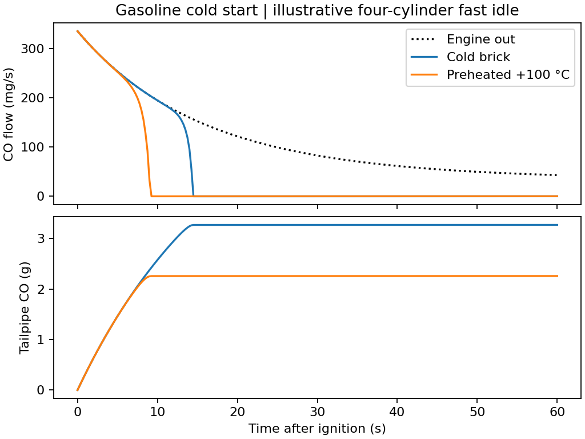

# Cylinder combustion

Three Python scripts visualize spark ignition in an 86 mm bore. The first two examine the first 125 µs after ignition. The third follows piston motion and combustion over 105 degrees of crank rotation.

## Early ignition viewed from above


The outer panels have the same scale. Watch the pressure pulse reach the wall around 86 µs while the flame is still near the plug. Cantera supplies equilibrium gas properties. A prescribed 18 m/s flame front drives a radial acoustic solver in a fixed chamber. Pressure colors show the local deviation from the chamber mean.

## Vertical section through the piston


Each frame advances one degree of crank rotation. The model uses slider-crank geometry, a prescribed burn rate, and uniform chamber pressure. Heat release initially outpaces expansion after top dead center (TDC). In this example pressure peaks at 54 bar absolute at 19° after TDC.

## Run on Windows

Install 64-bit Python 3.12 with the Windows Python launcher and Git for Windows. Open PowerShell in the directory where you want the repository, then run:

```powershell
git clone https://github.com/christophermitchell012/cylinder_combustion.git
cd cylinder_combustion
py -3.12 -m venv .venv
.\.venv\Scripts\python.exe -m pip install numpy scipy matplotlib pillow cantera==3.2.0
```

If you already have the repository, open PowerShell in its root and start at the virtual-environment command. Calling the environment's Python executable directly also works when PowerShell script activation is disabled.

| Run from the repository root | Output written in the current directory |
|---|---|
| `.\.venv\Scripts\python.exe cylinder.py` | `cylinder-propagation.png` with six radial snapshots and a grid-refinement comparison printed to the terminal |
| `.\.venv\Scripts\python.exe animate.py` | `cylinder-animation.gif` with 51 top-down frames |
| `.\.venv\Scripts\python.exe stroke.py` | `cylinder-cross-section.gif` with 106 vertical-section frames |

Open a generated image from PowerShell, for example with `Invoke-Item .\cylinder-cross-section.gif`. The example GIFs embedded above live in `animations/` so you can regenerate local outputs without overwriting the previews.

## Catalytic converter after a gasoline cold start



Run `python converter_lightoff.py` from the repository root with NumPy, SciPy and Matplotlib installed. On Windows with the environment above use `.\.venv\Scripts\python.exe converter_lightoff.py`. The script writes the figure and a CSV with inlet and outlet CO flow, brick temperatures, and cumulative emissions. Use `--output-dir <directory>` to choose the destination.

The example compares an initially 20 °C brick with a 120 °C brick over the same 60 seconds. The model gives **3.269 g versus 2.258 g tailpipe CO**. It uses the charge mass from the ignition state in stroke.py, assumes four cylinders, and prescribes fast-idle RPM, exhaust temperature, and an engine-out CO mole fraction decreasing from 1.4%. Oxygen enters at half the CO mole fraction. A lumped heat balance warms the brick. Eighty axial segments consume CO and oxygen, using local reactive partial pressure and a quasi-steady CatMAP Pt(111) turnover rate per site. The example neglects oxygen storage, reaction heat, competing species, thermal gradients, and gas transport limitations. Site inventory and effective thermal mass are illustrative.

### Measured gasoline-engine comparison

[Table 5 of the gasoline-engine cold-start WLTC experiment](https://pmc.ncbi.nlm.nih.gov/articles/PMC13629048/#sec3) gives measured cumulative tailpipe CO for seven cases over the initial approximately 500 s. [bench.csv](converter/bench.csv) transcribes the CO masses and operating schedules. Negative time denotes seconds before the test starts. Secondary air, when enabled, is 200 standard L/min. These are published integrated measurements.

The script also runs the two cases without secondary air for 500 s. It matches their 1 kW heater schedule and window while retaining the illustrative inlet and treating heater power as fully delivered to the effective brick. Base and Case 1 measured **6.39 and 3.39 g**; the model gives **3.49 and 2.99 g**. It underestimates the heating benefit (roughly 0.50 g versus 3.00 g measured). The experimental WLTC load, inlet composition, heater-to-brick coupling, and vehicle catalyst differ from the demonstration. This comparison checks direction and exposes the magnitude error. The 60 s preheat example is a separate experiment. The other five measurement rows include secondary air, which this model does not simulate.

### Regenerating the CatMAP rate table

The default script reads the committed 516-point [rate table](converter/rates.csv). To rerun CatMAP itself, use Python 3.12 and Git:

```sh
python -m pip install "ase==3.26.0" "git+https://github.com/SUNCAT-Center/catmap.git@ed04f9146a787b0e63b6febd96d8fe3b314c251b"
python converter/build_rates.py
```

[CatMAP's Pt(111) tutorial](https://github.com/SUNCAT-Center/catmap/tree/ed04f9146a787b0e63b6febd96d8fe3b314c251b/tutorials/thermodynamic_descriptors) supplies the surface mechanism and energies.txt, including the original energy references. The rate calculation assumes irreversible CO adsorption and CO2 production as in that example. It sweeps 300–930 K and log10 reactive pressure from -7 to -1.5 at a fixed 2:1 CO:O2 ratio. The reactor sets turnover to zero below the lower table limits. Results depend on this mechanism and the assumed gas composition.
