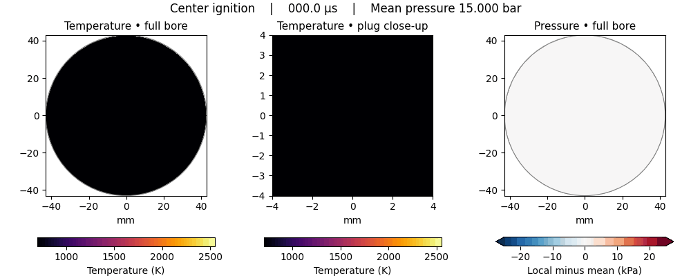
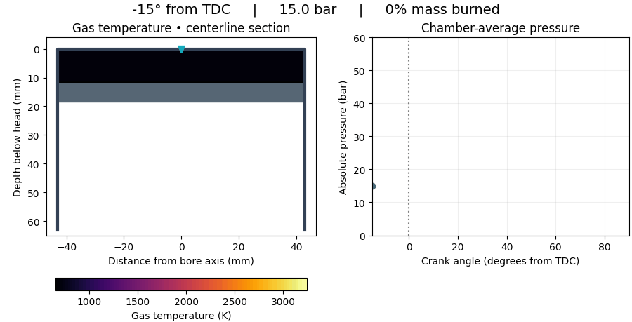

# Cylinder combustion

Three Python scripts visualize spark ignition in an 86 mm bore. The first two examine the first 125 µs after ignition. The third follows piston motion and combustion over 105 degrees of crank rotation.

## Early ignition viewed from above



The outer panels have the same scale. Watch the pressure pulse reach the wall around 86 µs while the flame is still near the plug. Cantera supplies equilibrium gas properties. A prescribed 18 m/s flame front drives a radial acoustic solver in a fixed chamber. Pressure colors show the local deviation from the chamber mean.

## Vertical section through the piston



Each frame advances one degree of crank rotation. The model uses slider-crank geometry, a prescribed burn rate, and uniform chamber pressure. Heat release initially outpaces expansion after top dead center (TDC). In this example pressure peaks at 54 bar absolute at 19° after TDC.

## Run on Windows

Install 64-bit Python 3.12 with the Windows Python launcher and Git for Windows. Open PowerShell in the directory where you want the repository, then run:

```powershell
git clone https://github.com/christophermitchell012/cylinder_combustion.git
cd cylinder_combustion
py -3.12 -m venv .venv
.\.venv\Scripts\python.exe -m pip install numpy scipy matplotlib pillow cantera==3.2.0
```

If you already have the repository, open PowerShell in its root and start at the virtual-environment command. Calling the environment's Python executable directly also works when PowerShell script activation is disabled.

| Run from the repository root | Output written in the current directory |
|---|---|
| `.\.venv\Scripts\python.exe cylinder.py` | `cylinder-propagation.png` with six radial snapshots and a grid-refinement comparison printed to the terminal |
| `.\.venv\Scripts\python.exe animate.py` | `cylinder-animation.gif` with 51 top-down frames |
| `.\.venv\Scripts\python.exe stroke.py` | `cylinder-cross-section.gif` with 106 vertical-section frames |

Open a generated image from PowerShell, for example with `Invoke-Item .\cylinder-cross-section.gif`. The example GIFs embedded above live in `animations/` so you can regenerate local outputs without overwriting the previews.
